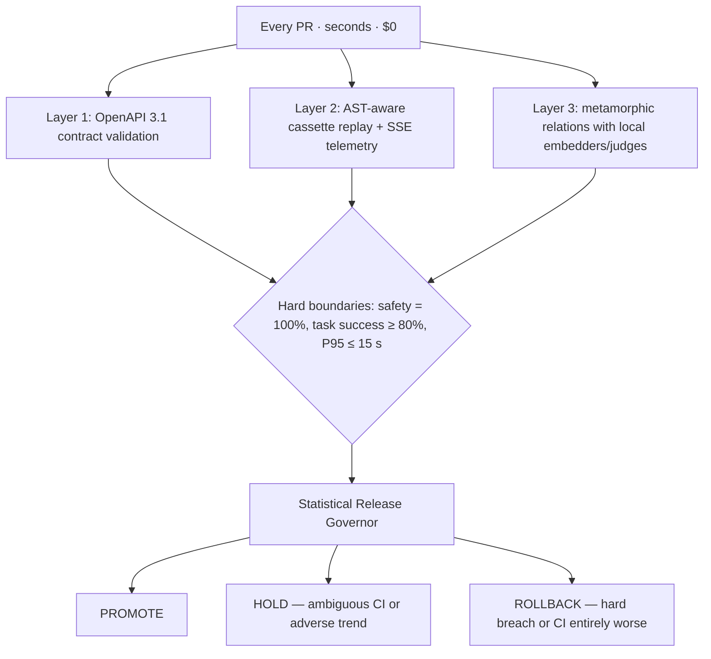

# DriftGate — Architecture and Design (Maintainer Reference)

> This document is for maintainers and contributors. If you only want to run
> the test suite, start with the [README](../README.md).


DriftGate is an open-source API quality-gate framework for **non-deterministic GenAI microservices**. It puts a decoupled, three-layer test pyramid in front of every change a team ships: deterministic contract validation first (sub-millisecond, $0 token cost), AST-aware record/replay second, and probabilistic metamorphic evaluation third — all feeding a statistical **PROMOTE / HOLD / ROLLBACK** release governor.

## Why deterministic first

LLM-judge evaluation is expensive (tokens), slow (seconds per call), and noisy (judge variance). Putting a probabilistic gate on every pull request creates the classic rework trap: slow, metered feedback makes engineers queue changes, batch deploys, and stop trusting the gate. DriftGate's PR path is therefore fully deterministic and offline:

| Layer | What it checks | Cost | Latency | Runs on |
|---|---|---|---|---|
| 1 — Contract gate | OpenAPI 3.1 / JSON Schema Draft 2020-12 validation of status codes and request/response bodies | sub-ms, $0 | every PR | precompiled `jsonschema` validators |
| 2 — Replay gate | AST-aware cassette record/replay of real traffic (whitespace-, timestamp-, ID-, bearer-insensitive fingerprints) | ms, $0 | every PR | recorded YAML cassettes |
| Streaming probe | SSE frame parsing by semantic delimiter, TTFT / inter-token-latency SLAs, `[DONE]` and `event: error` invariants | ms, $0 | every PR | live or replayed streams |
| 3 — Metamorphic gate | Paraphrase / entity-swap / context-order / adversarial-noise invariance; binary rubric judges | free local baseline; LLM judge opt-in | nightly | deterministic hashing embedder + rubric judges by default |
| Release governor | Bootstrap CIs (B=10,000) + tie-corrected Mann-Kendall trend over the five-dimension matrix | ms, $0 | nightly / release | metrics history |

The nightly path is the only one that can spend tokens, and only when a team explicitly configures a real judge provider and an API key. Every PR check works with `judge.provider: deterministic` (the default) and no key present.

## The three-layer pyramid



### Layer 1 — Deterministic contract gate

`driftgate.contracts.validator.ContractValidator` precompiles a `Draft202012Validator` per `(method, path template, status)` at load time (via `referencing.Registry`; OpenAPI documents are registered explicitly because they lack `$schema`). Runtime validation is pure `iter_errors` — sub-millisecond and allocation-light. Undeclared statuses, missing required fields, and type violations are aggregated (never fail-fast), non-JSON media types such as CSV downloads pass through untouched, and errors arrive in deterministic order.

### Layer 2 — AST-aware cassette replay

Requests are fingerprinted by:

1. filtering volatile headers (`authorization`, cookies, api keys, dates, `x-*`-id patterns);
2. recursively canonicalizing the body (ignored volatile fields dropped, keys sorted, numbers unified);
3. normalizing string payloads — strings that look like code (newline/`;` + keyword/assignment/balanced-paren heuristic) are parsed with `ast.parse` and dumped **without line attributes**, so formatting-only edits fingerprint identically; a `SyntaxError` falls back to whitespace collapsing. Fingerprinting never throws;
4. hashing the canonical JSON with SHA-256.

Cassettes are versioned YAML with **secrets redacted before persistence** (`authorization` → `[REDACTED]`), FIFO replay for repeated identical requests, strict mode raising `CassetteMissError` (assertion), and atomic saves. SSE bodies are stored as parsed semantic frames and replayed one canonical wire frame per chunk — proving the streaming probe never depends on TCP chunk boundaries.

### Streaming probe

`driftgate.streaming.probe` splits bytes on SSE frame delimiters (never TCP chunks — a 1-byte feed is valid input), tracks TTFT and per-token ITL, and enforces:

- HTTP 200 + `text/event-stream` content type *before* parsing;
- no mid-stream `event: error` frames (structured failures must surface as errors, not silence);
- clean termination: the `[DONE]` marker arrived and no partial frame dangles — "missing [DONE]" and "dangling partial frame" are distinguished;
- TTFT / max-ITL SLAs (skipped automatically on replayed streams, which have no meaningful latency, unless `allow_replay=True`).

**CR-normalization rules (SSE spec-correct).** Per the SSE spec a line terminator is `\n`, `\r\n`, **or a bare `\r`**. The parser therefore:

1. first normalizes CRLF → LF;
2. then normalizes any remaining lone `\r` → LF, *except* a trailing `\r` at the buffer end, which is kept pending — it may be the first byte of a CRLF split across chunks (joining `b"...\r"` + `b"\n..."` correctly produces one terminator, not two).

This matters for producers mixing endings: `b"data: x\r\n\rdata: y\n\n"` contains a bare-`\r` blank-line delimiter between two frames. A parser that only handles CRLF silently corrupts the next field line (name `"\rdata"`) and drops `data: y`. Covered by `test_parser_treats_bare_cr_as_line_terminator_per_spec`.

### Known defects in the example service (pinned, not fixed)

`examples/express_mock/server.js` (vendored from the reference gist) intentionally ships with one known defect, pinned by `test_known_defect_non_numeric_item_yields_null_total` so the framework demonstrably catches it:

- **NaN `totalAmount`:** order `items` is validated only as an array; `items: [0]` (bare numbers, wrong element shape) passes that check, then `quantity * unitPrice` evaluates to NaN and JSON serializes it as `null`. The mock answers `202 {"totalAmount": null, ...}`, violating the declared `totalAmount: number` contract. The same NaN path fires for string quantities (`"abc" * 5`) and overflow (`1e300 * 1e300`). DriftGate's Layer-1 contract gate is what flags the response.
- Related acceptance gaps (noted, not pinned): negative quantities/prices are accepted silently (`totalAmount: -99` → 202); whitespace-only `customerId`/`shippingAddress` pass the truthiness check; double-cancel returns `200 CANCELLED` twice (idempotent, arguably fine).

If the server is ever fixed to reject these, the pin test fails with instructions to update it and this document.

### Layer 3 — Probabilistic/metamorphic gate

Deterministic, zero-network by default:

- **Relations** (all local): `ParaphraseRelation`, `EntitySwapRelation` (single-pass substitution — circular swaps can't undo each other), `ContextOrderPermutationRelation` (system first, last user message fixed), `AdversarialNoiseRelation` (structural oracle: variant must still pass Layer-1 validation).
- **Invariance**: `HashingEmbedder` — SHA-1-bucketed word + char n-gram hashing, L2-normalized, fully deterministic; cosine threshold default 0.90.
- **Judges**: `DeterministicRubricJudge` (keywords/forbidden patterns/non-empty) for PRs; `LLMRubricJudge` wraps any injected `Callable[[str], str]` transport — the package never imports an SDK at module scope. Both parse a G-Eval-style CoT prompt ending in `VERDICT: PASS|FAIL`; unparsable output retries once, then **fails closed**. Grading is binary and one judge per atomic dimension (bias-mitigation protocol).
- **Judge wiring** (`driftgate/metamorphic/factory.py`): `build_judge(config.judge)` is the single construction point. `provider: deterministic` → `DeterministicRubricJudge`; `provider: anthropic|openai` → `LLMRubricJudge` over a lazy-SDK transport (imports live inside the transport functions, so the PR-gate path never touches an SDK). The API key resolves from `judge.api_key_env` (default `DRIFT_GATE_JUDGE_API_KEY`); a missing key raises before any call. Default models: `claude-haiku-4-5-20251001` / `gpt-4o-mini`, `temperature=0`; override with `judge.model`. SDKs install via the optional extra: `uv sync --extra judge`.

### Statistical Release Governor

Tri-state decision with direction-aware semantics (`MetricDirection`: falling latency is *good*, falling task success is not):

1. any hard breach (safety < 100%, task success < 80%, P95 > 15 s, or a promoted advisory dimension) → **ROLLBACK** (all rules evaluated, not first-match);
2. bootstrap CI (B=10,000, seeded — reproducible across CI runs) entirely worse than baseline → statistical **ROLLBACK**; CI overlapping baseline → **HOLD**;
3. Mann-Kendall (tie-corrected, continuity-corrected, no SciPy) significant *toward worse* → **HOLD**; `insufficient_data` (n < 4) is a non-signal;
4. else → **PROMOTE**.

The five-dimension matrix: safety (hard), task success (hard), P95 latency (hard), context preservation (≥ 0.90, advisory), evidence coverage (≥ 0.85, advisory) — advisory dimensions can be promoted to hard in config.

## Schema-inference bootstrap (no maintained spec yet)

Most teams the framework targets don't have a maintained contract. Record traffic once, then bootstrap:

```bash
uv run driftgate infer-schema --from-cassettes cassettes --out docs/inferred.openapi.yaml
# Review the advisory document, then promote it to strict enforcement:
uv run driftgate infer-schema --from-cassettes cassettes --out docs/openapi.yaml --promote
```

Inference is deliberately conservative: a field is `required` only when present in **100%** of samples; disagreeing types widen to a union; observed values are documented in descriptions, never emitted as enforced `enum`s; ambiguous paths stay literal rather than guessed; groups below `--min-samples` are skipped with a warning, never guessed. Output is marked `x-driftgate-inferred: true`, which downgrades violations to advisory warnings until a human promotes the contract.

## Adoption tooling (any REST project in ~10 minutes)

Three commands take a team from "no spec, no tests" to a governed gate:

```bash
uv add driftgate                                        # 1. install (plugin auto-registers)
uv run driftgate init --base-url http://localhost:8000  # 2. scaffold
uv run driftgate capture --base-url http://localhost:8000 --out openapi.yaml
#    then point contract.openapi_spec at openapi.yaml and run pytest
```

- **`driftgate init`** (`driftgate/scaffold.py`) writes three files, refusing to clobber anything that exists without `--force`: a `driftgate.config.yaml` pointing at the service, a starter `tests/api/test_api.py` (readiness probe via `driftgate_client`, plus one happy-path test per declared spec operation when `--spec` is given — path params probed with non-existent sentinels, POST bodies derived from required properties), and a `.github/workflows/driftgate.yml` PR gate (uv sync, optional `--start-service-command` step, pytest, `driftgate report` appended to `$GITHUB_STEP_SUMMARY`, `.driftgate/` artifact upload at 90 days). `.gitignore` gains `.driftgate/` and `cassettes/`.
- **`driftgate capture`** (`driftgate/capture.py`) records live traffic into cassettes: either a user-supplied YAML request list (`--requests`, each entry `{method, path, headers, body}`; `--auth-header` is prepended) or a default probe of well-known paths (`/`, `/healthz`, `/health`, `/openapi.json`, `/openapi.yaml`, `/docs`, `/api-docs`, `/status` — discover-but-limited by design). With `--out`, it chains `infer_openapi_spec` and writes the advisory contract. Unreachable services fail fast with instructions; DriftGate never starts or stops services.

## Build report (per-build QA view)

Every pytest run now ends with three artifacts in `.driftgate/` (written by the plugin's `pytest_sessionfinish` via `driftgate/reporting.py`; any failure in this pipeline logs a stderr warning and never changes the pytest exit code):

- **`report.json`** — machine-readable `ReportData`: run id, timestamp, pytest exit status, totals (passed/failed/errors/skipped), per-endpoint rows `{method, template, tests, failed, statuses_seen}`, spec coverage (declared vs exercised + % + uncovered list), the governor decision when `metrics.json` exists, and the spec diff.
- **`report.md`** — the same data rendered as deterministic markdown (also re-rendered by `driftgate report [--json]`); CI appends it to the job summary.
- **`spec-snapshot.json`** — the structural snapshot of the configured spec for this build.

**How traffic is attributed:** the plugin patches `httpx.Client.send` class-wide for the session (installed at `pytest_configure`, identity-checked restore at `pytest_unconfigure`), so requests from plugin fixtures *and* user-created clients are captured. A thread-local nodeid set by `pytest_runtest_logstart`/`logfinish` attributes each call to the running test; off-test calls land in a `(session)` bucket. Storage is a bounded set of unique `(method, path, status)` triples per test (64/test, 5000 tests) — Hypothesis examples collapse into the set, so fuzz suites cost nothing extra. Concrete paths are bucketed into spec templates via `ContractValidator.template_for()`; undeclared paths fall back to a first-two-segments bucket. Per-test outcomes come from `pytest_runtest_logreport` (setup/teardown failures count as errors). Async clients and xdist aggregation are out of scope (documented in the roadmap).

**Spec diff** (`driftgate/specdiff.py`): each build snapshots the configured spec (per operation: request/response property names, required lists, per-property and per-status schema digests) and diffs it against the previous build's snapshot. Findings are classified conservatively — endpoint/status/property removal, a new required field, or a property type change are **breaking**; endpoint/status/property additions are **additive**; a schema digest change with no identifiable structural cause is **info**. This is what drives the report's "Changed vs last build" section: the dev's PR that adds an endpoint shows up there without any gate-side changes.

**Governor history finally has a producer.** Until now nothing wrote `history.json`, so the Mann-Kendall trend machinery was starved. The CLI is the single producer: `run` appends the evaluated metrics to `governor.history_path` (ring buffer of 100, atomic write, corrupt file restarts fresh), and `gate` appends only when `--history` is explicitly passed — which also no longer requires the file to pre-exist (the cold-start bootstrap deadlock is fixed). Bare `pytest` never writes history, so the series stays "governed builds only".

## Configuration

`driftgate.config.yaml` parses into a strict Pydantic v2 model hierarchy (`driftgate/config.py`). Every section has a default, so the framework is usable with zero configuration; any value can be overridden with `DRIFT_GATE_<SECTION>__<KEY>` environment variables (double underscore = one nesting level; the overlay is the only place raw env strings are read).

`examples/driftgate.service.template.yaml` is the fully-documented manifest template. It is itself **under test**: `examples/tests/test_config_driven_order_export.py` loads every documented key through `DriftGateConfig.load()` — a renamed key fails the suite, so the template cannot rot silently.

Supported `traffic_mode` values: `record`, `replay_strict`, `replay_lenient`, `live`, `auto_record` (replay on hit; call live and record only on a miss). Translation to the internal `CassetteMode` enum happens at exactly one point (`CassetteMode.from_traffic_mode`); CLI `--cassette-mode` has precedence over config.

## Commands

```bash
# Run pytest with the plugin, then govern .driftgate/metrics.json if produced.
# Exit codes: PROMOTE=0, ROLLBACK=1, HOLD=2.
uv run driftgate run --config driftgate.config.yaml

# Record cassettes while exercising tests against a running service.
uv run driftgate record --config driftgate.config.yaml

# Pure governor run on a metrics artifact (what nightly CI calls).
uv run driftgate gate --metrics .driftgate/metrics.json --history .driftgate/history.json

# Schema-inference bootstrap from recorded cassettes.
uv run driftgate infer-schema --from-cassettes cassettes --out docs/openapi.yaml

# Scaffold a new project (config + starter suite + CI workflow).
uv run driftgate init --base-url http://localhost:8000 [--spec openapi.yaml] [--force]

# Record live traffic to cassettes; optionally infer an advisory contract.
uv run driftgate capture --base-url http://localhost:8000 \
  [--requests calls.yaml] [--auth-header "Authorization: Bearer x"] [--out openapi.yaml]

# Re-render the last build's report (markdown, or --json).
uv run driftgate report

uv run driftgate version
```

**Scope boundary:** `driftgate` never starts or stops the target service. `service.base_url` must already be reachable; process lifecycle is owned by the caller (CI job steps, dev scripts).

## Pytest plugin

The plugin registers via the `pytest11` entry point. Fixtures:

| Fixture | Purpose |
|---|---|
| `driftgate_config` | Validated `DriftGateConfig` with CLI overrides applied |
| `driftgate_recorder` | Per-test `CassetteStore`, file named from the sanitized node ID (`@pytest.mark.driftgate_cassette("name")` for shared) |
| `driftgate_client` | sync `httpx.Client` with the `RecordingTransport` |
| `driftgate_contract` | Session `ContractValidator` (None when no spec configured) |

CLI options: `--driftgate-config PATH`, `--cassette-mode {record,replay_strict,replay_lenient,live,auto_record}`, `--record`, `--cassette-dir PATH`. Markers: `nightly`, `slow`, `live`, `driftgate_cassette`. `assert_streaming_sla(response)` consumes a stream and returns telemetry. `record_run_metrics(pytestconfig, safety_pass_rate=1.0, ...)` publishes metrics for `driftgate run` via a session-finish hook; the plugin's `pytest_sessionfinish` persists them to `.driftgate/metrics.json`.

**Layer-2 policy:** cassettes only for stateless routes (auth, 404s, chat streams). Time-driven server state must always run live — replaying an order state machine would lie.

## Demos and validation suites

- `examples/demo_service/` — FastAPI GenAI service with SSE `POST /v1/chat/completions` and `POST /v1/summarize`. Fault injection via `X-Demo-Behavior: normal | slow | invalid_schema | truncated | error_stream` reproduces every failure class deterministically. Its `openapi.yaml` is hand-written.
- `examples/tests/test_microservice_pipeline.py` — the three layers plus probe against the demo service.
- `examples/express_mock/` — vendored stateful order & export API (Node/Express) with a hand-written `openapi.yaml`, plus two non-deterministic demo endpoints: `GET /v1/recommendations` (catalog reshuffled per request with random scores; `?seed=<int>` reproduces a draw exactly) and `POST /v1/insights` (narrative drawn from a 6-variant answer pool — varying wording, stable meaning).
- `examples/tests/test_order_export_service.py` — endpoint coverage: auth, order creation math, state machine (PENDING→PROCESSING @5s→COMPLETED @15s), cancellation rules (409 after completion), export lifecycle (60 s completion), CSV download headers/content.
- `examples/tests/test_order_export_service_fuzz.py` — Hypothesis-generated adversarial payloads against the live mock; oracle: only declared 4xx/2xx statuses, schema-valid bodies, never a 500.
- `examples/tests/test_nondeterministic_examples.py` — the copy-paste patterns for testing AI-shaped endpoints: contract-on-every-draw (shape not values), output-diversity assertions with headroom, live-draw invariance with the hashing embedder (plus its fail-side check), seeded reproducibility, metamorphic entity substitution, and the deterministic rubric judge. Two `nightly`-marked tests add the LLM tier: `build_judge` from config grades 5 live insight draws with a semantic rubric (verdicts flow into `record_run_metrics` → the governor's task-success dimension) and checks a semantic-invariance pair that the free cosine oracle can only approximate. They execute **only when the judge is configured** — `DRIFT_GATE_JUDGE_API_KEY` set and the SDK installed (`uv sync --extra judge`; provider via `DRIFT_GATE_JUDGE_PROVIDER`, model via `DRIFT_GATE_JUDGE_MODEL`) — and skip with that reason otherwise. Adopters copy these patterns for their own non-deterministic endpoints. The demo service deliberately stays deterministic — its fixed token stream is what makes byte-identical cassette replay provable.
- `examples/tests/test_order_export_service_inference.py` — inference self-consistency: record real traffic → infer → every source interaction validates against the inferred contract; contract-breaking changes yield warnings, not errors.
- `examples/tests/test_config_driven_order_export.py` — the service template's executable proof (template loads, spec covers the API, config-driven contract gate validates real responses).

The stateful mock starts automatically for its tests via the session fixture (installs `npm` deps on first run). An external instance is also supported: set `DRIFT_GATE_EXPRESS_URL=http://localhost:3000/v1` to run against your own started server — the fixture probes the API's signature (unauthenticated `POST /v1/orders` → `401`) so it works against the unmodified gist, and fails fast with instructions if nothing answers.

### What the order/export suite validates, exactly

`examples/express_mock/server.js` is a vendored copy of the public reference server at
<https://gist.github.com/sharanya-lb/b429b6e807f95a8df8216c4343ff6766> (behavior-identical; only
a `/healthz` readiness endpoint, a `PORT` env override, and the two non-deterministic demo endpoints
were added — those are absent from the unmodified gist, so
`test_nondeterministic_examples.py` skips when ``DRIFT_GATE_EXPRESS_URL`` points at the gist).
The order & export test suites
(`test_order_export_service*.py`) exercise **that specific server**: its exact status codes, error
bodies (`Missing credentials`, `Invalid payload`, `Cannot cancel completed order`, …), the 5 s/15 s
order state machine, the 60 s export completion window, and the exact CSV report body
(`orderId,status,totalAmount` + `ORD-10001,COMPLETED,150.00` / `ORD-10002,CANCELLED,45.50` rows).
The gist is vendored rather than fetched so tests never depend on the network and never change when
the gist is edited.

The **example tests validate the spec file**, not just the code: every suite drives a
`ContractValidator` built from `examples/express_mock/openapi.yaml` (hand-written OpenAPI 3.1
describing the gist's API). Successful login and order-creation responses are checked against the
declared response schemas on every run, and the fuzz layer's safety oracle is defined purely by that
spec: generated inputs may produce any *declared* status (200/202/400/401/404/409) with a
schema-valid body — anything else (undeclared status, shape violation, 500) fails the suite. This
is the framework's Layer-1 gate exercised on a real, hand-maintained contract.

## CI

`.github/workflows/driftgate-gate.yml` defines two jobs:

- **`framework-tests`** — every PR/push, runs first (both jobs wait on it). Server-free and seconds-fast: `uv run pytest tests/ --timeout=60 -v`. This is the gate that catches driftgate-package regressions before any server machinery spins up; a framework change breaks here first.
- **`pr-gate`** — every PR/push, after `framework-tests` passes. Installs uv, starts the mock with a `/healthz` readiness wait, runs `uv run pytest -m "not nightly" --timeout=180 -v` (framework + service suites together). Structural and $0: pinned deterministic judge, no API key in scope, no code path reaching an LLM. Artifacts (`.driftgate/`, `cassettes/`) upload with 90-day retention.
- **`nightly-eval`** — cron + manual + `run-evals` PR label. Runs `-m nightly`, then `driftgate gate --metrics .driftgate/metrics.json --history <previous night's artifact>` (direction-aware CI-straddle + Mann-Kendall), uploads `.driftgate/` artifacts with 90-day retention and chains history between runs.

## When your service is one of many microservices: do we need Pact?

DriftGate is a template framework any API team drops into their repo. Its guarantees are provider-side: the service honors its declared contract (Layer 1), never 500s under adversarial input (fuzz), streams within SLA (probe), and isn't statistically drifting (governor) — and every build hands QA a report showing what changed, what's covered, and whether the build is worth testing. That's the gate that keeps invalid builds away from QA and shortens the QA cycle.

What DriftGate cannot answer in a mesh is: "**which downstream consumers did my change just break?**" Consumer knowledge lives in other teams' repos, outside the provider gate's sight. Before adding any tool for that, know what the ecosystem offers and what DriftGate already replaces:

| Tool | Role in a mesh | DriftGate equivalent | Verdict |
|---|---|---|---|
| `oasdiff` | OpenAPI backward-compatibility diff gate per PR | `driftgate/specdiff.py` (breaking/additive/info per build) | **Already built** — don't add a second diff engine |
| Schemathesis | Property-based testing from OpenAPI against a live service | Fuzz layer (Hypothesis + ContractValidator oracle) | **Already built** |
| **Pact + broker** | Consumer-driven contracts: pact files from each consumer, provider verification, `can-i-deploy`, change fan-out | *(nothing — this is the gap)* | **Add only when tier 2 applies** |
| Microcks | Central OpenAPI/AsyncAPI conformance catalog + mocks | Layer 1 per service | Org-scale catalog tool; not needed per-service |
| Spring Cloud Contract | CDC for all-JVM/Spring estates | N/A (polyglot Python) | Only for all-Spring adopters |

> **Division rule:** **DriftGate** = "I honor my declared contract, my quality isn't drifting, and QA gets a trustworthy report per build." **Pact** = "I didn't break the other services that depend on me." They are complements; Pact never replaces Layer 1 — two response-validation engines mean two maintenance burdens for one job.

**Tiered adoption for adopting teams:**

- **Tier 0 — single team, single service (the default):** DriftGate alone. Layer 1 + spec diff + build report already cover the "don't break consumers" risk at PR time.
- **Tier 1 — CDC-lite (few consumers, same org):** each consumer commits a `consumer-calls.yaml` (what it sends, which response fields it reads); the provider's CI replays those calls against its spec. `driftgate capture` already produces this shape — consumer-driven testing with **no broker**.
- **Tier 2 — Pact + broker (many teams, independent deploy cadences, recurring cross-team breakage):** Pact for **inter-service contracts only**, DriftGate for everything intra-service.

### What kinds of tests Pact should own (and what it must not own)

At tier 2, use Pact for the inter-service handshake only:

- **Consumer-side contract tests** — each consumer runs Pact tests against a mock of the provider, producing a *pact file* recording what it requests and which fields it asserts on. This is the consumer's PR gate.
- **Provider verification** — the provider replays every consumer's pact file against the real service, *next to* DriftGate's Layer 1 (not instead of it). Pact matching rules cover consumer-critical fields only; full response shapes stay owned by the OpenAPI spec — never assert the same schema twice.
- **`can-i-deploy`** — before a deploy, the broker answers "is this build verified against every consumer currently in production?" This deploy-time coupling check is the one thing nothing else provides.
- **Change fan-out** — broker webhooks notify downstream teams the moment a pact starts failing.

Do **not** use Pact for: fuzz/adversarial input (pact matching is example-shaped — "never 500s on garbage" stays a DriftGate fuzz job); non-deterministic/AI outputs (SSE streams, LLM judges, metamorphic invariance, statistical drift are outside Pact's deterministic-matching model); response *quality* (task success, latency SLAs, context preservation — the governor's job); or QA-signoff reporting (the build report remains the artifact QA reads to decide whether a build is testable).

### Test kinds per direction in a mesh

| Concern | Tool | Cadence |
|---|---|---|
| Service honors its declared spec | DriftGate Layer 1 | every PR |
| Service doesn't break recorded consumer expectations | Pact provider verification | every PR |
| A consumer's requests are still valid against the latest upstream spec | Consumer-side Pact tests + upstream spec diff | consumer's PR |
| Service quality isn't drifting (latency, success, AI output) | DriftGate Layers 2–3 + governor | PR + nightly |
| Upstream changed shape under you | Your DriftGate run against the refreshed spec + broker notifications | your PR / nightly |
| Deploy safety across independent teams | `can-i-deploy` against the broker matrix | every deploy |

**Cheapest 80% before any broker:** a consumer-registry in the build report — config lists which services consume which endpoints; when the spec diff finds a breaking change, the report names the affected consumers. Most of Pact's coordination value, a fraction of its infrastructure. The broker earns its operational cost only past ~5 services with recurring cross-team incidents.

## Roadmap (post-MVP)

Deliberately cut, all documented rather than silently absent:

- **Rust/PyO3 core** — Layer-1 engine in `jsonschema-rs` for >10 k validations/frame budgets (MVP uses precompiled pure-Python validators).
- **Async transport** — an `httpx.AsyncBaseTransport` mirror when a real async caller exists.
- **Position-swap invariance** — pairwise judge comparisons (targets A-vs-B judging, not this MVP's single-output rubric flow).
- **Token-usage budget capture/assertion** — add when a token-metered provider integration needs it.
- **Multi-agent trajectory diffing** and **provider-agnostic SDK interception** (OpenAI/Anthropic/vLLM).
- Phased maturation of the advisory dimensions and nightly auto-tuning.

Post-adoption-tooling items, in the order each unblocks the next:

- **Spec-derived fuzz strategies** (`scaffold --fuzz`) — Hypothesis strategies generated from declared request schemas, making fuzz coverage zero-effort for new endpoints.
- **`driftgate report --publish`** — export report.md as a PR comment / GitLab discussion.
- **Actionable coverage tripwire** — diff-aware coverage assertion with an instruction-bearing failure message.
- **Trend annotations in the report** — Mann-Kendall arrows per metric once history has ≥ `min_history_runs` entries.
- **`driftgate diff`** — standalone spec-diff command with `--fail-on-breaking` for pre-test CI enforcement.
- **Consumer-registry in the build report** — config lists which services consume which endpoints; when the spec diff finds a breaking change, the report names the affected consumers (the "cheapest 80%" Pact substitute described in the mesh section above).
- **CDC-lite consumer-call replay** — a documented `consumer-calls.yaml` shape (produced by `driftgate capture`) that consumer repos commit, with provider-side CI replay against the spec — tier-1 consumer-driven testing without a broker.
- **xdist support** — controller-side aggregation of the per-worker call/outcome maps (the worker-write skip guard shipped with the report is the hook point).
- **Semantic breaking-change analysis** — specdiff beyond structure (recorded-traffic replay against the new spec, enum narrowing, oneOf membership changes).
- **Per-endpoint coverage floors** — fail a run when spec coverage drops below a configured minimum.
- **Reusable GitHub Action** (`action.yml`) — collapse the generated CI workflow into a `uses:` line once the generated workflow shape stabilizes across adopters.

## References

- Khan, S., Mughees, A., Sudheerbabu, G., Ahmad, T., & Truscan, D. — *Multi-Agent LLM-Based Metamorphic Testing for REST APIs* (ARMeta). <https://arxiv.org/html/2605.28321v1> — metamorphic-relation oracle approach (Layer 3).
- Maiorano, A. C. — *Automated Self-Testing as a Quality Gate: Evidence-Driven Release Management for LLM Applications*. <https://arxiv.org/html/2603.15676v1> — five-dimension gate matrix and the PROMOTE/HOLD/ROLLBACK statistical release protocol.
- Vandeputte, F. — *Foundational Design Principles and Patterns for Building Robust and Adaptive GenAI-Native Systems*. <https://arxiv.org/html/2508.15411v1> — GenAI-native reliability/assurance design pillars underpinning the framework's motivation.
